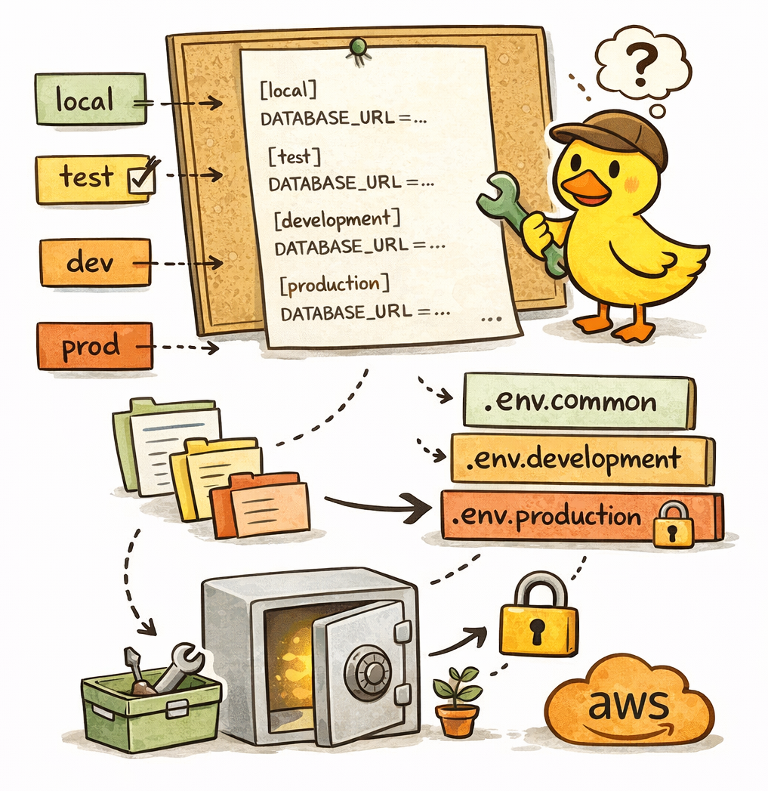

# Configuration Management

<p align="center">
  
</p>

Managing application configuration is often more complex than it appears.

Modern applications usually have many configuration parameters spread across multiple files and environments. The same
application may run in different environments such as:

- local
- test
- development
- production

A common problem at the start of many projects is keeping configuration documentation up to date. Developers often
struggle to understand how to correctly configure the application locally.

The approach used in this project solves this problem by combining versioned configuration, local overrides, and secure
secret management.

## Environment Configuration Strategy

The configuration system is built around two main files - `.env.common`, `.env`

`.env.common` - this is the primary configuration file used for local development.

Characteristics:

- contains the environment variables the application needs, except `JWT_SECRET`
- configured for running the application locally once `JWT_SECRET` is set in `.env` (the README quick start appends it)
- does not contain sensitive secrets
- committed to the repository

Because this file is versioned, it acts as living documentation for all configuration variables required by the
application.

`.env` - this file is used for local overrides.

Sometimes developers need to change specific configuration values locally. For example:

- running a database on a different port
- using a local Redis instance
- modifying debug options

Instead of modifying `.env.common`, developers can override values in `.env`.

Example scenario:

A developer needs to override the database port locally.

```dotenv
DATABASE_PORT=5332
```

Key properties:

- overrides variables defined in `.env.common`
- not committed to the repository
- optional for developers
- prevents merge conflicts between team members

Each developer may have their own `.env` file.

## Test Environment Overrides

For test environments, some parts of the system configuration may also need to be overridden. For example, throttle
limits may need to be increased because automated tests that repeatedly call the API could otherwise be blocked or
disable Sentry for test env.

Example:

```dotenv
THROTTLE_TTL=20000000
THROTTLE_LIMIT=10000
SENTRY_ENABLED=false
```

Throttling variables: `THROTTLE_LIMIT` (default `60`), `THROTTLE_TTL` in ms (default `60000`), `THROTTLE_ENABLED` (default `true`) and `TRUST_PROXY` (Express trust-proxy hop count, default `0`; set `1` behind ALB so the limit is per client rather than global). The throttling e2e file overrides the limits in-process (`THROTTLE_LIMIT=3`) so it does not affect other e2e files.

For such cases, we can use a dedicated `.env.test` file that overrides values from `.env.common` specifically for test
execution.

## Secret Management

Sensitive secrets such as:

- database passwords
- API keys
- JWT secrets
- third-party credentials

are never stored in `.env.common` or baked into the Docker image. `.env.common` holds non-secret defaults only; for local
development put secrets in `.env`. The image contains neither `.env` nor `.env.common`.

Instead, secrets are injected directly into the container at runtime using Terraform.

This approach provides several important benefits:

- secrets are not visible in the repository
- secrets are not exposed during CI/CD
- secrets are stored securely in infrastructure systems (e.g. AWS Secrets Manager)
- only infrastructure-level access can retrieve them

In practice, secrets are passed to the container during deployment via Terraform configuration.

This significantly reduces the attack surface compared to storing secrets in environment files.

## NestJS Configuration Setup

In this project, NestJS loads configuration from both `.env` and `.env.common`.

`.env` takes precedence over `.env.common`.

Example configuration:

```typescript
ConfigModule.forRoot({
  envFilePath: [join(process.cwd(), '.env'), join(process.cwd(), '.env.common')],
});
```

The same logic is applied in the database manager:

```shell
config({
  override: false,
  path: [
    join(process.cwd(), '.env'),
    join(process.cwd(), '.env.common'),
  ],
});
```

This ensures that:

1. `.env.common` provides default values
2. `.env` can override them locally if needed

## Structured Configuration Modules

At the application level, configuration is divided into semantic modules.

Instead of loading configuration as a large unstructured object, we split it into logical domains such as:

- app
- database
- redis

This makes configuration easier to understand, test, and maintain.

Example configuration module:

```typescript
class AppConfig {
  @IsString()
  APP_DESCRIPTION = packageJson.description || 'Description';

  @IsString()
  APP_HOST = '0.0.0.0';

  @IsString()
  APP_NAME = packageJson.name || 'App';

  @IsNumber()
  @Transform(({ value }) => Number(value))
  APP_PORT = 3000;

  @IsString()
  APP_VERSION = packageJson.version || '1.0.0';

  @IsNumber()
  @Transform(({ value }) => Number(value))
  SHUTDOWN_DRAIN_MS = 10000;

  @IsNumber()
  @Transform(({ value }) => Number(value))
  SHUTDOWN_INFLIGHT_TIMEOUT_MS = 20000;
}

export const appConfig = registerAs<AppConfig, ConfigFactory<AppConfigInterface>>(
  'appConfig',
  (): AppConfigInterface => {
    const config = validateConfig(AppConfig);

    return {
      appDescription: config.APP_DESCRIPTION,
      appHost: config.APP_HOST,
      appName: config.APP_NAME,
      appPort: config.APP_PORT,
      appVersion: config.APP_VERSION,
      shutdownDrainMs: config.SHUTDOWN_DRAIN_MS,
      shutdownInflightTimeoutMs: config.SHUTDOWN_INFLIGHT_TIMEOUT_MS,
    };
  },
);
```

This approach provides several benefits:

- configuration validation
- typed configuration
- clear separation of concerns
- predictable configuration access

## Accessing Configuration

Configuration values are accessed through NestJS ConfigService.

Example:

```typescript
const configApp = configService.getOrThrow<ConfigType<typeof appConfig>>('appConfig');

await app.listen(configApp.appPort, configApp.appHost);
```

Using getOrThrow ensures that the application fails fast if a required configuration value is missing.

## Why This Approach Works Well

This configuration strategy provides several advantages:

- configuration becomes self-documented
- developers can run the project immediately after cloning
- secrets remain secure and outside the repository
- configuration is type-safe and validated
- configuration is organized into small, predictable modules

As the project grows, this structure allows the configuration system to scale without becoming difficult to maintain.

## Variable Reference and Production Values

The image contains no `.env` files, so in ECS every variable comes from the task definition that the terraform
repository renders (`infrastructure/modules/task_definition`, documented in its `docs/workflow.md`, section "Backend
configuration"). Secrets come from AWS Secrets Manager through the task definition `secrets`, never from plain
`environment`. At release time CD renders the migration task (`ecs/migration-task.json`) with
`scripts/render-migration-task.sh`, which copies the roles, `environment` and `secrets` of the latest application task
definition revision with `jq` (JSON-valued entries such as `API_ALLOWED_ORIGINS` keep their escaping; CI checks the
render with `scripts/render-migration-task.test.sh`). The migration task therefore has the same variables as the
application only when terraform was applied before the release: a release run against a revision registered before the
terraform change copies that older set.

"Default" is the value in `src/config/*.config.ts` (or `database-manager/generate-url.ts`, `src/tracing.ts`), used when
the variable is unset. "Required" means the backend refuses to start without it. In the ECS column, "constant" is fixed
by the infrastructure and `backend_config.<name>` is a per-environment terraform setting whose default equals the backend
default.

| Variable                                     | Default             | Required        | ECS task definition                                                            |
| -------------------------------------------- | ------------------- | --------------- | ------------------------------------------------------------------------------ |
| `NODE_ENV`                                   | `development`       | no              | env, constant `production`                                                     |
| `APP_HOST`                                   | `0.0.0.0`           | no              | env, constant `0.0.0.0`                                                        |
| `APP_PORT`                                   | `3000`              | no              | env, constant `3000` (container port)                                          |
| `APP_NAME`, `APP_DESCRIPTION`, `APP_VERSION` | `package.json`      | no              | not set: taken from the image                                                  |
| `SHUTDOWN_DRAIN_MS`                          | `10000`             | no              | env, `backend_config.shutdown_drain_ms`                                        |
| `SHUTDOWN_INFLIGHT_TIMEOUT_MS`               | `20000`             | no              | env, `backend_config.shutdown_inflight_timeout_ms`                             |
| `API_PREFIX`                                 | `api`               | no              | env, constant `api`                                                            |
| `API_ALLOWED_ORIGINS`                        | `[]`                | no              | env, `https://<domain>` and `https://<cloudfront domain>` of the web client    |
| `API_ALLOWED_NON_BROWSER_ORIGINS`            | `true`              | no              | env, `backend_config.api_allowed_non_browser_origins`                          |
| `TRUST_PROXY`                                | `0`                 | no              | env, constant `1` (the ALB)                                                    |
| `JWT_SECRET`                                 | -                   | yes (32+ chars) | secret, `<project>/<env>/jwt-secret`                                           |
| `JWT_TTL`                                    | `3600`              | no              | env, `backend_config.jwt_ttl`                                                  |
| `DATABASE_HOST`                              | -                   | yes             | env, RDS endpoint                                                              |
| `DATABASE_PORT`                              | -                   | yes             | env, RDS port                                                                  |
| `DATABASE_NAME`                              | -                   | yes             | env, RDS database name                                                         |
| `DATABASE_USER`                              | -                   | yes             | env, RDS master user                                                           |
| `DATABASE_PASSWORD`                          | -                   | yes             | secret, RDS-managed master secret (`password` key)                             |
| `DATABASE_SSL`                               | `false`             | no              | env, constant `true`                                                           |
| `DATABASE_POOL_MAX`                          | `10`                | no              | env, `backend_config.database_pool_max`                                        |
| `DATABASE_CONNECT_TIMEOUT_MS`                | `5000`              | no              | env, `backend_config.database_connect_timeout_ms`                              |
| `DATABASE_STATEMENT_TIMEOUT_MS`              | `5000`              | no              | env, `backend_config.database_statement_timeout_ms`                            |
| `DATABASE_FAIL_FAST`                         | `true`              | no              | env, `backend_config.database_fail_fast`                                       |
| `DATABASE_LOG_LEVELS`                        | `[]`                | no              | env, `backend_config.database_log_levels`                                      |
| `LOG_LEVEL`                                  | `info`              | no              | env, `backend_config.log_level`                                                |
| `LOG_PRETTY`                                 | `true`              | no              | env, constant `false` (JSON for CloudWatch Logs)                               |
| `LOG_EXCLUDE_ENDPOINTS`                      | `[]`                | no              | env, `backend_config.log_exclude_endpoints`                                    |
| `HEALTH_CHECK_TRIGGER_MS`                    | `15000`             | no              | env, `backend_config.health_check_trigger_ms`                                  |
| `REDIS_ENABLED`                              | `true`              | no              | env, constant `true`                                                           |
| `REDIS_HOST`                                 | `localhost`         | no              | env, ElastiCache primary endpoint                                              |
| `REDIS_PORT`                                 | `6379`              | no              | env, ElastiCache port                                                          |
| `REDIS_TLS`                                  | `false`             | no              | env, constant `true`                                                           |
| `REDIS_PASSWORD`                             | -                   | no              | secret, `<project>/<env>/redis-auth`                                           |
| `SENTRY_ENABLED`                             | `false`             | no              | env, `backend_config.sentry_enabled`                                           |
| `SENTRY_DSN`                                 | `""`                | no              | secret, `SENTRY_DSN` key of the app config secret, only when Sentry is enabled |
| `SENTRY_IGNORED_ERRORS`                      | `[]`                | no              | env, `backend_config.sentry_ignored_errors`                                    |
| `SWAGGER_ENABLED`                            | `true`              | no              | env, constant `false` (docs are never served in production anyway)             |
| `SWAGGER_ENDPOINT`                           | `docs`              | no              | not set (unused in production)                                                 |
| `THROTTLE_ENABLED`                           | `true`              | no              | env, `backend_config.throttle_enabled`                                         |
| `THROTTLE_LIMIT`                             | `60`                | no              | env, `backend_config.throttle_limit`                                           |
| `THROTTLE_TTL`                               | `60000`             | no              | env, `backend_config.throttle_ttl`                                             |
| `OTEL_EXPORTER_OTLP_ENDPOINT`                | unset (tracing off) | no              | env, `backend_config.otel_exporter_otlp_endpoint`, omitted when empty          |

Sentry sends events only when `SENTRY_ENABLED=true` and `SENTRY_DSN` is non-empty; either one alone keeps it off.

## Database TLS

`DATABASE_SSL=true` appends an `sslmode` to the connection URL built by `database-manager/generate-url.ts`. The
application, the seeds and `db:wait` connect through `pg` with `sslmode=verify-full`: the server certificate and host
name are verified. (`pg` 8 currently treats `require` the same way but warns at every start, and `pg` 9 switches
`require` to libpq semantics without verification, so `verify-full` is spelled out.) RDS certificates are issued by the RDS
CA, which is not in Node's built-in CA store, so the production image downloads the AWS global RDS bundle
(`https://truststore.pki.rds.amazonaws.com/global/global-bundle.pem`) to `/etc/ssl/certs/rds-global-bundle.pem` and
sets `NODE_EXTRA_CA_CERTS` to it. Node then trusts the RDS CA in addition to the public roots; verification stays on.
`prisma migrate deploy` (the migration task) reads `prisma.config.ts`, which asks for `sslmode=require`: Prisma's schema
engine documents only `disable`, `prefer` and `require`, and with `require` it encrypts without verifying the
certificate.

## Redis TLS and AUTH

`REDIS_TLS` accepts only `true` or `false` (default `false`). When `true`, ioredis connects with `tls: {}`, which uses
Node's default CA store with certificate verification on; ElastiCache certificates chain to a publicly trusted Amazon
root, so no custom CA is needed. `rejectUnauthorized` is never disabled, and the TLS server name is taken from
`REDIS_HOST`, so use the endpoint hostname. `REDIS_PASSWORD` is the optional AUTH token; if `REDIS_TLS=true` in
production without it, a warning is logged at startup.

Redis clients reconnect forever with capped backoff (`min(attempt * 200, 5000)` ms) and log the first and every 10th consecutive failure, while
commands fail fast during an outage (cache reads degrade to a miss).
