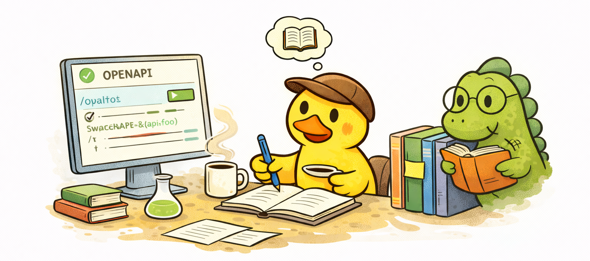

# Documentation

  

The documentation process is an ongoing process throughout development. Each feature should be accompanied by at least
Swagger/OpenAPI documentation and possibly a Readme.

For most backend services, maintaining a large and complex documentation system is unnecessary.

Full documentation portals (for example using Docusaurus) make sense when you are building:

- public APIs
- SDKs
- shared libraries used by multiple teams
- developer platforms

In such cases, detailed documentation with usage examples, integration guides, and edge cases becomes essential.

However, for a typical backend service or internal API, maintaining a separate documentation platform often becomes a
burden. Documentation can quickly become outdated because developers must constantly synchronize:

- code changes
- integration examples
- API behavior
- documentation links

For most projects, a simpler approach works better.

## Recommended Documentation Structure

This project keeps documentation lightweight and close to the codebase.

Key documentation files include:

### README.md

The main entry point for developers. It should explain:

- project purpose
- architecture overview
- setup instructions
- development workflow

### Swagger / OpenAPI

Swagger serves as the primary API documentation for developers and QA engineers.

It provides:

- endpoint descriptions
- request/response schemas
- validation rules
- example requests

The API contract is committed as `docs/openapi.json`. It is generated from the controllers and DTO decorators by
`npm run openapi:export`, which needs neither Postgres nor Redis nor real secrets nor any `.env` file: the script sets a
placeholder (`??=`, so real values still win) for every config value that has no default. The frontend and mobile clients
consume this file to generate their API types, so it is the single source of truth for the HTTP surface.

Rules:

- any change to a route, DTO or Swagger decorator must be followed by `npm run openapi:export` and the updated
  `docs/openapi.json` must be committed in the same change
- `npm run openapi:check` regenerates the document in memory and fails when it differs from the committed file
- the e2e test `test/openapi.e2e-spec.ts` fails with the same hint when the committed file has drifted, so CI blocks a
  contract change that was not exported

The interactive reference (Scalar) is served at `SWAGGER_ENDPOINT` outside production and is not protected by
credentials.

In this project, Swagger also includes custom decorators that simplify repetitive patterns such as pagination.

It is important to document not only successful responses, but also error responses, so that API consumers understand
all possible outcomes.

## Additional Useful Documents

### CHANGELOG.md

Tracks the evolution of the project:

- new features
- bug fixes
- breaking changes

This file helps developers understand how the system evolved over time.

### Incident Log

Production incidents are rare, but when they occur they should always be documented.

An incident log typically includes:

- when the incident occurred
- what caused the issue
- how it was resolved
- what measures were introduced to prevent it in the future

This becomes especially important if a system was compromised or experienced a serious outage.

Incident documentation is extremely useful for:

- internal audits
- improving operational processes
- long-term system reliability

### Feature Change Log

In some teams, business analysts maintain documentation describing how product features evolve over time.

This documentation records:

- the original behavior of a feature
- what changes were introduced
- why the change was made

From an engineering perspective, this helps developers better understand the business logic behind the product.

### Roadmap

For projects without a formal backlog or task tracker, a roadmap.md file can serve as a lightweight planning document
listing upcoming features and directions.
