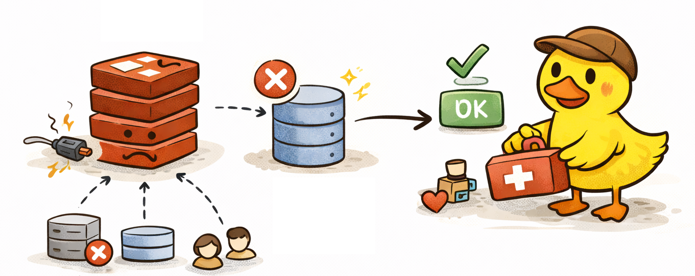

# Fault Tolerance

<p align="center">
  
</p>

## Fault vs Failure

It’s important to distinguish between two types of issues in a system: fault and failure.

A **Fault (Non-Critical Dependency)** occurs when a non-critical part of the system is not working or is functioning incorrectly.
In this case, the system as a whole continues to operate, but:

- the user may experience partial degradation of functionality
- some features may be temporarily unavailable
- or a fallback mechanism is used to preserve the core user experience

A **Failure (Critical Dependency)** occurs when a critical part of the system fails, or the entire system becomes unavailable.
For example:

- the database is unavailable
- the application cannot serve requests
- core business logic is broken

In the book _Designing Data-Intensive Applications_ (Martin Kleppmann):

> Faults should be tolerated,
> while Failures should be prevented or minimized.

This project demonstrates a simple fault-tolerance strategy using Redis as an example.

## Non-Critical Dependency

In this architecture, Redis is treated as a non-critical component.

If Redis becomes unavailable, the system continues functioning using fallback strategies instead of crashing.

Redis integration is implemented inside the redis-manager module.

```shell
src/modules/redis-manager/
```

In this project Redis is used for two main purposes:

- caching
- request throttling (rate limiting)

### Fallback Strategies

Fallback mechanisms are implemented inside the storages directory.

```shell
src/modules/redis-manager/storages/
```

These implementations demonstrate how the system can gracefully degrade when Redis is not available.

#### Caching Strategy

Redis caching is considered a performance optimization, not a critical system dependency.

If Redis becomes unavailable, caching is simply skipped and the application reads data directly from the database.

This ensures that the system remains functional even if performance temporarily degrades.

Invalidation rules per operation (`<id>` is the todo id, `<userId>` the owner):

| Operation | Cache effect                                                                     |
| --------- | -------------------------------------------------------------------------------- |
| create    | delete `todos:<userId>:*` (all cached lists of the owner)                        |
| update    | delete `todo:<id>` and `todos:<userId>:*`                                        |
| delete    | delete `todo:<id>` and `todos:<userId>:*`                                        |
| read      | `todo:<id>` (60 s) and `todos:<userId>:<query>` (30 s) are filled on a miss only |

A request for a todo owned by another user is rejected before any cache write or invalidation.

Pattern invalidation uses `SCAN` (`scanStream` with `COUNT 100`) and `UNLINK` in batches, never `KEYS`. `KEYS` walks the whole keyspace in one blocking call, so on a large Redis it stalls every other command (including throttling and health checks) for the duration. `SCAN` is incremental and non-blocking, at the cost of weaker guarantees: it is not atomic, keys created during the scan may be missed, and a key can be returned twice (harmless for deletion). The cache client uses the `cache:` key prefix, which ioredis does not apply to `SCAN` `MATCH`, so the storage adds it to the match pattern and strips it from returned keys before `UNLINK`.

Known limitation: there is no stampede protection. When a hot key expires or is invalidated, concurrent requests all miss and hit the database until one of them refills the cache. TTL jitter or request coalescing can be added if this becomes a measurable problem.

Metrics: `cache_operations_total{operation="get|set|del", result="hit|miss|ok|error"}`. The "Cache hit ratio" panel in `observability/dashboards/metrics.dashboard.json` shows `hit / (hit + miss)` for `get`.

#### Throttling Strategy

Rate limiting is more important for system stability, so a fallback is implemented.

If Redis is unavailable, the application switches to an in-memory fallback using a simple Map structure.

This allows the throttling mechanism to continue working, although with some limitations:

- limits apply only per instance
- data resets when the service restarts

Even with these constraints, this fallback provides basic protection against abuse while Redis is unavailable.

## Types of Fault Tolerance

Fault-tolerant systems are often discussed in two categories (as described by Martin Kleppmann):

This project follows High Availability principles - the end user does not see the difference when working with the
application.

### High Availability

High Availability - the system continues to operate without noticeable disruption. Failures are handled
transparently, and the user does not see that a fallback or recovery mechanism was triggered.

### Graceful Degradation

Graceful Degradation - the system remains partially available, but the user may notice issues, such
as reduced functionality or visible errors, while core parts of the system still work.

## In-Flight Requests Handling

When deploying a new version, there may still be active user requests being processed.

To handle this safely, the application uses an in-flight requests tracking approach.

Each incoming request is tracked via a middleware, which increments an internal counter. Once a request is completed,
the counter is decremented.

`RequestTrackingService` must be a single instance: it is provided only by `RequestTrackingModule`, which both
`AppModule` (where `RequestTrackingMiddleware` runs) and `ShutdownModule` import. Declaring it again in another module's
`providers` creates a second counter that the shutdown hook never sees incremented.

If the counter is greater than zero, it means there are still active requests being processed.

Shutdown happens in three phases, driven by NestJS lifecycle hooks (`enableShutdownHooks()` is on):

1. `beforeApplicationShutdown` (drain): the service flips to the shutting-down state and waits `SHUTDOWN_DRAIN_MS`
   (default 10000). `/health` returns `503` during this time while the HTTP server still accepts connections, so the
   load balancer stops routing new traffic and in-flight requests keep completing with `200`. NestJS runs this hook
   before it closes the HTTP server.
   After the drain it waits up to `SHUTDOWN_INFLIGHT_TIMEOUT_MS` (default 20000) for in-flight requests to finish and
   logs `Waiting for <n> in-flight requests to finish...`.
   This must happen here: once the hook returns, Nest closes the HTTP server, and `server.close()` has no upper bound
   on how long it waits for active requests.
2. HTTP server close: `forceCloseConnections: true` (set in `NestFactory.create`) destroys any connection still open,
   so requests that exceeded the in-flight timeout are forcefully terminated.
3. `onApplicationShutdown`: disconnects Prisma and Redis.

The sum of both values must stay below the ECS `stopTimeout` (60s, set in terraform), otherwise ECS sends `SIGKILL`
before shutdown finishes.

### Manual Check

```bash
docker compose up production
while true; do curl -s -o /dev/null -w "%{http_code}\n" localhost:3000/health; sleep 0.5; done
docker kill -s TERM production
```

Expected: `200` responses, then `503` for about 10 seconds, then connection refused once the port closes. A slow
request started before the signal must still finish with `200`.

## Critical Dependency

The database is a critical dependency. If database is not available, the application will shutdown:

```typescript
if (this.config.databaseFailFast) {
  process.exit(1);
}
```
