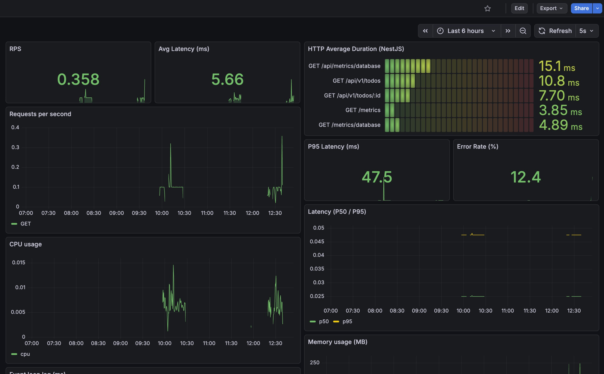

# Logging & Observability

<p align="center">
  
</p>

Logging is one of the most important parts of building production systems.

Once an application is deployed to production, logs become the primary feedback channel that allows engineers to
understand what is happening inside the system.

The better your logging strategy is designed, the easier it becomes to:

- diagnose production issues
- investigate incidents
- understand system behavior
- track request flows

## Application Logging

In this project the logging system is built on top of Pino, a high-performance Node.js logger.

The logger uses structured logging with built-in log levels.

Each log entry contains the following fields:

- application name
- timestamp
- correlation ID
- log level
- message
- context

Example log structure:

```json
{
  "level": 30,
  "timestamp": "2026-03-12T16:05:49.626Z",
  "env": "development",
  "appName": "Todo_inst1",
  "traceId": "4209c5e7-bf00-45d1-87c9-ef9db57f8da5",
  "levelName": "info",
  "pid": 61190,
  "ctx": "loggingMiddleware",
  "method": "GET",
  "msg": "Request income"
}
```

This format is intentionally designed to be machine-readable, which allows logs to be easily parsed and visualized in
tools such as Grafana.

## What Should Be Logged

Logging every layer of the application is not recommended.

For example, logging every database query error is usually unnecessary if the error is correctly handled and never
reaches the global exception handler.

A good rule of thumb is:

_Log application-level events, not internal implementation details._

Typical examples of useful logs:

- incoming requests (method, path and trace ID only, never the body)
- business operations
- important state changes
- unexpected errors

During development, it can still be useful to enable additional logs (for example ORM query logging) in order to debug
SQL queries generated by the ORM.

## GDPR Considerations

Logging must always respect privacy and security regulations.

Sensitive user data should never be logged.

Avoid logging:

- email addresses
- usernames
- passwords
- credit card information
- authentication tokens

Logs are usually stored for a period of time and often accessible to multiple systems.
If logs are compromised, any sensitive information stored inside them may also be exposed.

For the same reason, when sending errors to monitoring systems such as Sentry, it is recommended to only attach minimal
user context:

```typescript
Sentry.setUser({ userId });
```

Using only a userId allows engineers to identify the affected user in the database without exposing personal data.

The request logging middleware follows the same rule. The `info` entry carries `method`, `path` (without the query
string) and the trace ID, and never the request body. Body parsers run before the logging middleware (`useRequestLogging`), so the body is available to it. The body is emitted only at `debug` level, under `req.body`, and
the pino `redact` configuration (`src/logger/log-redact.ts`) replaces `req.body.password`, `req.body.email` and
`req.body.token` with `[REDACTED]`. Keep `LOG_LEVEL` at `info` or above in production anyway.

Client-submitted logs (`POST /api/v1/client-logs/web` and `/mobile`) are written at `warn` with `ctx: 'client-logs'`.
Free-text fields have `MaxLength` limits, and the endpoints are public (signed-out pages such as login send logs) but
throttled to 20 requests per minute per client. `metadata.fullUrl` and `metadata.url` are logged without their query
string and hash. `actions[].payload` is logged as sent, so clients must not put personal data in it (frontend contract).

## Trace ID

A Trace ID is used to connect all logs that belong to the same request.

Each incoming request receives a unique identifier which is propagated through the entire application.

This allows engineers to reconstruct the full request flow when debugging issues.

For example:

```shell
Request → Controller → Service → Database → Response
```

All logs generated during this flow will contain the same traceId.

This becomes extremely useful when investigating production errors.

## Context

The ctx field identifies where in the application the log was generated — for example, the name of the middleware,
service, or handler that produced the entry.

## Distributed Tracing

A trace id and a span are different things. The trace id identifies one request across every service it touches
(it is also what the `x-trace-id` header and the `traceId` log field carry). A span is one timed operation inside that
trace: the HTTP request, an Express handler, a `pg` query, an `ioredis` command. Logs answer "what happened", spans
answer "where did the time go".

`src/tracing.ts` starts the OpenTelemetry `NodeSDK` from `src/instrument.ts` (before any other import, because
auto-instrumentation patches `http`, `express`, `pg` and `ioredis` at require time). Spans are exported over OTLP/HTTP to
Tempo. Tracing is enabled only when `OTEL_EXPORTER_OTLP_ENDPOINT` is set (compose sets `http://tempo:4318` on
`production`); without it `startTracing()` does nothing, so unit and e2e tests are unaffected. The service name is
`APP_NAME` and the version is `APP_VERSION`. The `@opentelemetry/instrumentation-router` instrumentation is disabled:
Express 5 routes through the `router` package that the express instrumentation already covers, and the router one adds a
response `finish` listener per middleware layer, which triggers `MaxListenersExceededWarning` on every request.

When an OpenTelemetry span is active, `traceIdMiddleware` uses its trace id for `x-trace-id`, the response header and
the log `traceId`. Without a span (tracing disabled) it falls back to an incoming `x-trace-id` header, then a random
UUID. A log line therefore links straight to its trace: Grafana's Loki datasource has a `traceId` derived field that
opens the matching trace in Tempo.

### Coexistence with Sentry

`@sentry/node` v10 is built on OpenTelemetry and would otherwise register its own global `TracerProvider`; a second
provider is silently ignored, so one of the two would lose spans. When `OTEL_EXPORTER_OTLP_ENDPOINT` is set,
`instrument.ts` initialises Sentry with `skipOpenTelemetrySetup: true` and `tracing.ts` builds the one provider with
Sentry's `SentrySpanProcessor`, `SentrySampler`, `SentryPropagator` and `SentryContextManager` next to the OTLP exporter.
Sentry keeps instrumenting `http`, `express`, `pg` and `ioredis` itself, so those four are disabled in the auto
instrumentations to avoid duplicate spans. Without the endpoint Sentry owns its own setup as before.
`@sentry/opentelemetry` is pinned to the same version as `@sentry/node`, and the OpenTelemetry packages are pinned to the
2.x line that Sentry uses (`sdk-node` 0.214.0), because mixing OpenTelemetry SDK majors breaks the shared context.

### Context propagation

Services pass the trace on with the W3C `traceparent` header (`00-<trace-id>-<parent-span-id>-<flags>`). The SDK reads it
on incoming requests and writes it on outgoing ones, so a trace started in the browser continues in the API. When Sentry
is active the propagator is a composite of the W3C propagator and Sentry's, and Sentry runs with
`propagateTraceparent: true`, so both `traceparent` and `sentry-trace`/`baggage` are accepted and emitted. A client
can send either `traceparent` or `sentry-trace`/`baggage`. The web client sends neither today (only `x-trace-id`, and
`browserTracingIntegration` adds `sentry-trace` only to same-origin and localhost requests by default), so every API
request from it starts a new trace. Whether the Sentry sampler respects a sampling decision
extracted from a W3C parent cannot be checked in the local stack (it runs with `SENTRY_ENABLED=false`); verify it in an
environment with a Sentry DSN.

### Sampling and cost

With Sentry active the Sentry sampler decides, so only `tracesSampleRate` (0.2) of traces reach Tempo too. Without
Sentry every trace is sampled. Spans are batched and flushed on shutdown (`ShutdownService`, after the drain and
in-flight phases). Tempo keeps blocks locally for 48 hours; for real traffic lower the sample rate first, since span
volume (storage and exporter CPU) grows linearly with it.

## Observability Stack

This project includes a basic observability stack that allows engineers to monitor logs and system metrics.

The stack consists of the following components:

- Promtail – log collector
- Loki – log storage and indexing
- Grafana – visualization and dashboards
- Prometheus – metrics collection system
- Tempo – distributed trace storage

## Running the Stack Locally

`docker-compose.yml` runs the app together with the full stack on one `backend` network. All images are pinned
(Prometheus `v3.5.0`, Grafana `12.2.0`, Loki and Promtail `3.5.0`, Tempo `2.8.2`), and the versions match the
monitoring host in `prod-forge/terraform`.

```shell
npm run db:generate                              # clean clone only; also needs .env, see README Getting started
docker compose up -d database cache
npm run db:migration:deploy && npm run db:seed   # once, needs DATABASE_PORT=5332 in .env, against the compose database on localhost:5332
./scripts/verify-observability.sh                # builds and starts everything, then checks it end to end
docker compose down                              # stop the stack, volumes are kept
```

The `production` container reads `.env.common` and `.env` through `env_file`, and compose `environment:` overrides
what must differ inside the network: `DATABASE_HOST=database`, `DATABASE_PORT=5432`, `REDIS_HOST=cache`,
`OTEL_EXPORTER_OTLP_ENDPOINT=http://tempo:4318` and `LOG_PRETTY=false` (JSON lines, so Promtail and the Loki trace
link can parse them). `JWT_SECRET` falls back to the non-secret value `local-dev-only-jwt-secret-0123456789` when it
is not set in the shell or in `.env`; never use that value outside a laptop.

| Service    | URL                     | Notes                                                         |
| ---------- | ----------------------- | ------------------------------------------------------------- |
| App        | `http://localhost:3000` | `/health`, `/health/live`, `/health/deps`, `/metrics`         |
| Grafana    | `http://localhost:3001` | `admin` / `admin`; datasources and 3 dashboards provisioned   |
| Prometheus | `http://localhost:9090` | Scrapes `production:3000/metrics` as job `nestjs-app`, alerts |
| Loki       | `http://localhost:3100` | Logs shipped by Promtail from the Docker socket               |
| Tempo      | `http://localhost:3200` | Traces over OTLP HTTP on `tempo:4318` (network only)          |

`scripts/verify-observability.sh` (needs `curl` and `jq`) asserts, in order: `/health` is 200, login with a seeded user
works, 50 authenticated requests to `/api/v1/todos` return at least one 200 (the per-user throttler answers the rest
with 429), `prisma_queries_total` is above zero, Prometheus reports `up{job="nestjs-app"} == 1`, Grafana is healthy and
has exactly 3 dashboards, Tempo is ready and its search API returns a trace, and Loki holds an app log line whose
`"traceId":"<32 hex>"` matches the Grafana derived field that links logs to Tempo. The stack is left running for
inspection.

Grafana provisions dashboards from `observability/grafana/dashboards.yml`, which points at the
`observability/dashboards` folder mounted into `/var/lib/grafana/dashboards`. Edit dashboards in that folder, not in
the UI: provisioned dashboards are read-only.

## Logging Pipeline

The logging workflow in this project looks like this:

1. The application writes logs to stdout inside the container.
2. Promtail collects logs from the container runtime.
3. Promtail sends logs to Loki.
4. Loki indexes and stores logs.
5. Grafana queries Loki to visualize logs and build dashboards.

```shell
Application → stdout → Promtail → Loki → Grafana
```

This approach follows the cloud-native logging model, where applications do not manage log files directly.

## Dashboards

Preconfigured dashboards can be found in:

```shell
observability/dashboards
```

<p align="center">
  
</p>

These dashboards provide visualization for:

- application logs
- system metrics
- database activity

They serve as a starting point for building more advanced monitoring setups.

## Metrics with Prometheus

In addition to logs, the application also exposes metrics using Prometheus.

Prometheus periodically scrapes metrics from the application endpoint (usually /metrics).

Prometheus scrapes `/metrics` only. `/metrics/database` returns the slowest queries as JSON for humans and is not scraped.
Both live at the root, outside the API prefix, and are reachable only from inside the VPC: `metricsGateMiddleware` returns
404 for any metrics path (case-insensitive, with or without the API prefix) when the request carries `X-Forwarded-For`,
which the ALB always appends. Prometheus and the compose stack scrape the task directly, without that header.

Custom metrics (default `prom-client` process metrics are exposed as well):

| Metric                          | Type      | Labels                      | Description                                                                                 |
| ------------------------------- | --------- | --------------------------- | ------------------------------------------------------------------------------------------- |
| `http_requests_total`           | counter   | `method`, `route`, `status` | Completed requests, recorded once per request (errors use the error status)                 |
| `http_request_duration_seconds` | histogram | `method`, `route`, `status` | Request duration                                                                            |
| `http_requests_in_flight`       | gauge     | none                        | Requests being processed; decremented exactly once, also when a handler throws              |
| `http_errors_total`             | counter   | `method`, `route`, `status` | Requests that ended in an exception (recorded by the exception filter)                      |
| `prisma_query_duration_seconds` | histogram | none                        | Duration of each Prisma query, from Prisma query events                                     |
| `prisma_queries_total`          | counter   | none                        | Prisma queries executed                                                                     |
| `prisma_queries_per_request`    | histogram | none                        | Queries executed during one HTTP request (N+1 detector)                                     |
| `db_slow_query_mean_ms`         | gauge     | `queryid`                   | Mean time of the 10 slowest statements from `pg_stat_statements`, refreshed on every scrape |
| `service_health_status`         | gauge     | `service`                   | 1 when a dependency check is up, 0 otherwise                                                |
| `cache_operations_total`        | counter   | `operation`, `result`       | Cache `get`/`set`/`del` calls by outcome (`hit`, `miss`, `ok`, `error`)                     |

The `route` label is the route template (for example `/api/v1/todos/:id`), never the raw URL, so cardinality stays bounded.

`db_slow_query_mean_ms` needs the `pg_stat_statements` extension (see [Database Management](./database-management.md)). When it is missing, a warning is logged once and the gauge stays empty; `/metrics` keeps working.

The database ping behind `service_health_status` runs at most once per `HEALTH_CHECK_TRIGGER_MS` (default 15000), so frequent scrapes do not hit the database each time.

Example metric:

```shell
http_requests_total{method="GET",route="/api/v1/todos/:id",status="200"} 42
```

Grafana can then use Prometheus as a data source to build dashboards and alerts based on these metrics.

## Alerting and SLOs

Service level objectives for the API, measured over a rolling 30 days. Every SLI excludes probe and scrape traffic
(`route!~"/(health|metrics).*"`, i.e. `/health`, `/health/live`, `/health/deps`, `/metrics`, `/metrics/database`): readiness 503s during a shutdown drain and
Prometheus scrapes are not user requests.

| SLO          | Target               | Measured with                                                                        |
| ------------ | -------------------- | ------------------------------------------------------------------------------------ |
| Availability | 99.9%                | Share of non-5xx responses in `http_requests_total`, probes excluded                 |
| Latency      | p95 < 300 ms         | `histogram_quantile(0.95, ...http_request_duration_seconds_bucket)`, probes excluded |
| Error rate   | < 1% of requests 5xx | `http_requests_total{status=~"5.."}` over all requests, probes excluded              |

Alert rules live in `observability/prometheus/alerts.yml` and are loaded by Prometheus through `rule_files`. They fire
on symptoms well past the SLO, so a page means users are hurting now rather than that the error budget is shrinking:

| Alert            | Condition                                                   | For    | Severity |
| ---------------- | ----------------------------------------------------------- | ------ | -------- |
| `HighErrorRate`  | 5xx responses above 5% of all non-probe requests            | 5 min  | critical |
| `HighLatencyP95` | p95 duration of non-probe requests above 500 ms             | 10 min | warning  |
| `ServiceDown`    | `up{job="nestjs-app"} == 0`, or no target at all (`absent`) | 1 min  | critical |
| `InFlightStuck`  | more than 50 requests in flight                             | 10 min | warning  |

There is no Redis alert: Redis is an optional dependency and no metric reports its state (`service_health_status`
covers the readiness checks only). A Redis outage shows up as `cache_operations_total{result="error"}`.

Check the rules after editing them:

```shell
docker run --rm --entrypoint promtool -v "$PWD/observability/prometheus:/etc/prometheus:ro" \
  prom/prometheus:v3.5.0 check rules /etc/prometheus/alerts.yml
```

Locally the alerts are visible in Prometheus (`/alerts`) and Grafana only. In AWS the same rules run on the monitoring
host (`prod-forge/terraform` keeps a copy; this repository is the source of truth), still without Alertmanager, and
paging goes through CloudWatch alarms on the ALB, ECS and RDS that notify an SNS topic. Routing these Prometheus alerts
to SNS through Alertmanager is planned for phase 2b.

## Why Observability Matters

Combining structured logging, metrics, and monitoring dashboards allows teams to quickly:

- detect production issues
- investigate failures
- analyze system performance
- track error rates

A well-designed observability system is essential for operating production-grade applications.

## Health Checks and Terminus

Health checks are used by orchestrators to decide whether a service instance should receive traffic.

They should not represent a full system status, but instead answer:
can this instance handle requests right now?

In NestJS applications, health checks are commonly implemented with @nestjs/terminus, which provides structured health
indicators and standardized responses.

### Critical vs Optional Dependencies

Dependencies should be split into:

- critical — required for request handling (e.g. database)
- optional — non-blocking (e.g. cache like Redis)

Failure of a critical dependency must stop traffic.
Failure of an optional dependency should only degrade functionality.

Three endpoints serve three purposes:

| Endpoint       | Checks                          | Used by                                           |
| -------------- | ------------------------------- | ------------------------------------------------- |
| `/health/live` | none, returns `{"status":"ok"}` | Docker `HEALTHCHECK`, ECS container `healthCheck` |
| `/health`      | database and shutdown state     | ALB target group (readiness)                      |
| `/health/deps` | database and Redis              | debugging and monitoring                          |

### /health/live (Liveness)

Answers only "is the process up?" and runs no dependency check, so it stays `200` during a database outage. Use it
wherever a failure means the container is killed and restarted: the Dockerfile `HEALTHCHECK` (it honours `APP_PORT`)
and the ECS container `healthCheck`. Pointing those at `/health` would make a database outage
restart healthy tasks. The ALB target group keeps using `/health`, because there a failure should only stop traffic.

### /health (Critical)

Includes only critical dependencies.

Used by the orchestrator.
Must return non-200 if a critical dependency fails.

#### Readiness

Readiness indicates whether a service instance can safely receive traffic. It is used by orchestrators to decide if the
instance should stay in the load balancer. Unlike general health checks, readiness includes only critical dependencies
and lifecycle signals like shutdown state.

```ts
this.shutdownHealthService.check('shutdown');
```

On SIGTERM, readiness switches to `503` first and the HTTP server keeps accepting connections for
`SHUTDOWN_DRAIN_MS` (10s by default), so the load balancer deregisters the instance before the port closes. The global
exception filter passes the Terminus status through for health routes, so a failed check is a real `503`, not a `200`
with `"status":"error"` in the body. `isHealthPassthrough` (`src/error-handler/mappers/resolve-error.ts`) decides this
from the lowercased `req.path` (`/health` or `/health/...`; Express routing is case-insensitive and the query string is
ignored), and `HttpMetricsInterceptor` uses the same rule, so the drain `503` is labelled `status="503"` in
`http_requests_total`, not `500`. Every other 5xx `HttpException` is still reported and labelled as `500`.

### /health/deps (All)

Includes all dependencies (critical + optional).

Used for debugging and monitoring.
May report failures without affecting traffic: it returns `503` when a check is down, but nothing routes traffic on it.

#### Optional Dependencies Handling

Optional checks should not throw errors.

Instead, they should report degraded state:

```ts
return {
  redis: {
    status: 'down',
    message: 'optional dependency',
  },
};
```
