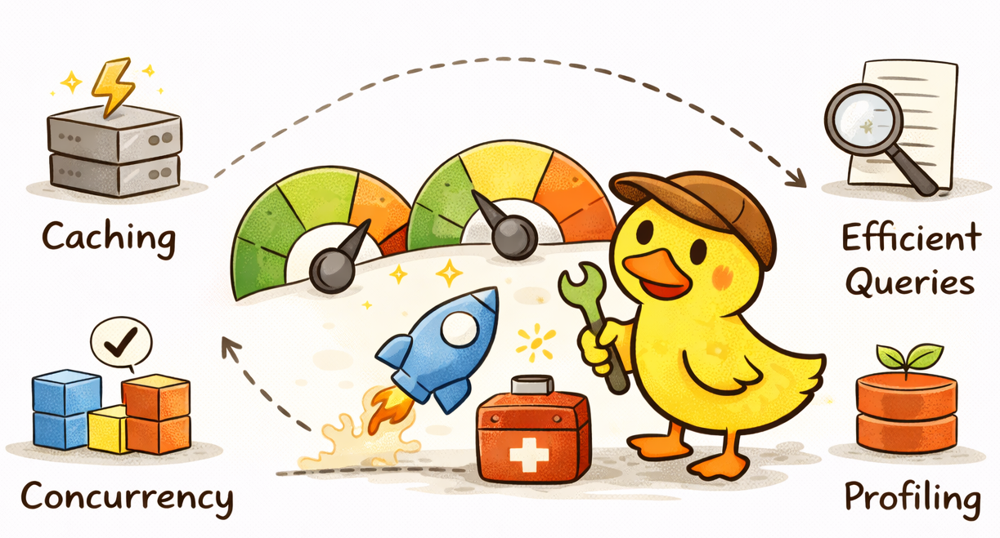

# Performance

<p align="center">
  
</p>

Performance optimization is a complex topic and heavily depends on the specific project and workload.

However, there are several general principles that apply to most backend systems.

## Avoid Returning Unnecessary Data

Do not return large payloads if they are not required.

This improves:

- API performance
- bandwidth usage
- security (less data exposure)

## Use Pagination for Collections

Endpoints that return collections should always support pagination.

This prevents:

- large database queries
- excessive memory usage
- slow responses

Pagination also makes APIs easier to consume.

### Pagination semantics

`GET /api/v1/todos` accepts `limit` (default 10, min 1) and `offset` (default 0, min 0). `offset` is the number of rows
to skip, so `offset=0` is the first row and the next page of `limit=10` starts at `offset=10`. The response `meta`
echoes `limit`, `offset` and `total`. The default order is `createdAt DESC`. Free-text `search` is limited to 100
characters, `title` to 200 and `description` to 2000, which bounds the work of a single query.

### Offset vs cursor pagination

Offset pagination with `count(*)` is kept for the Todo scale: per-user lists are small, the `(userId, createdAt)` index
serves the default order, and clients get a total and can jump to any page. The cost grows with the offset (the
database still walks the skipped rows) and `count(*)` scans every matching row.

Switch to cursor (keyset) pagination when a single user can own hundreds of thousands of rows, when deep pages are
requested, or when the list is an infinite feed that does not need a total. A cursor query filters on the last seen
`(createdAt, id)` instead of skipping rows. Cursor pagination is listed as out of scope in the README.

## Use Database Indexes (When Needed)

Indexes can significantly improve database performance for frequently queried fields.

However, they should be used carefully.

Too many indexes can negatively affect:

- write performance
- storage usage

Indexes should be introduced only when necessary. Current `Todo` indexes:

- `(userId, createdAt)` and `(userId, completed, createdAt)` for the default and the `completed` filtered lists
- `(userId, title)` for sorting a user's todos by title
- trigram GIN indexes on `title` and `description` (`pg_trgm`, `gin_trgm_ops`) for the case-insensitive
  `contains` search, which becomes `ILIKE '%term%'` and cannot use a btree index

The trigram indexes are created in a hand-written migration because Prisma cannot declare them in `schema.prisma`.

## Connection Pool and Timeouts

`PrismaService` passes the pool settings to the `pg` pool behind `@prisma/adapter-pg`:

| Variable                        | Default | Meaning                                                             |
| ------------------------------- | ------- | ------------------------------------------------------------------- |
| `DATABASE_POOL_MAX`             | `10`    | Maximum connections per application instance                        |
| `DATABASE_CONNECT_TIMEOUT_MS`   | `5000`  | How long a request waits to obtain a connection                     |
| `DATABASE_STATEMENT_TIMEOUT_MS` | `5000`  | Postgres `statement_timeout`: a slow query is cancelled server-side |

Idle connections are closed after 30 seconds. Size the pool so that `instances x DATABASE_POOL_MAX` stays below the
database `max_connections`. When the number of instances grows (autoscaling, many short-lived tasks), put a connection
pooler in front of Postgres: PgBouncer in transaction mode, or RDS Proxy on AWS, and keep the application pool small.

## Response Compression

In some cases it may be beneficial to compress responses using gzip.

Example configuration:

```typescript
app.use(compression({ threshold: 1024 }));
```

In this example compression is applied only to responses larger than 1 KB.

Compression can reduce network traffic, but it should be used only when it provides real benefits.

## Cache Invalidation Without KEYS

Never use the Redis `KEYS` command in production code: it scans the whole keyspace in a single blocking call and stalls all other clients. Pattern deletion uses `SCAN` with `COUNT 100` and `UNLINK` (non-blocking delete) in batches. Track cache effectiveness with the `cache_operations_total` metric and the "Cache hit ratio" dashboard panel.
