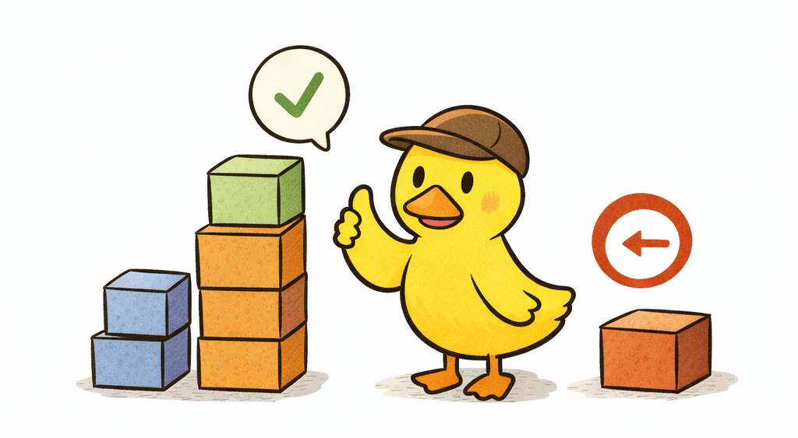
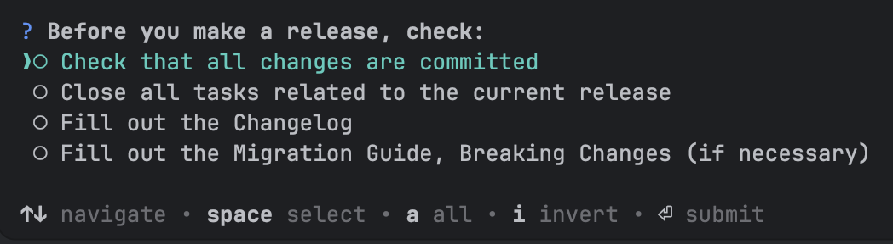
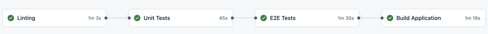
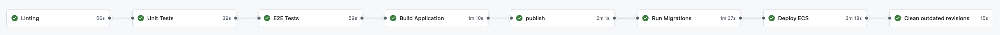
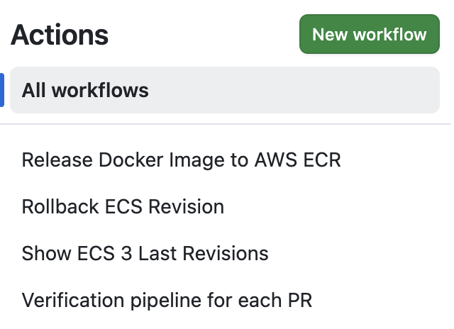
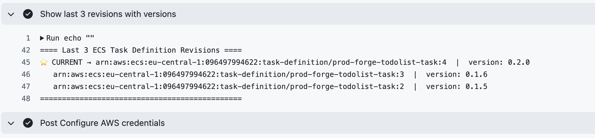

# Release Management

<p align="center">
  
</p>

Releasing software is not just a technical step - it is a structured process that ensures new functionality can be
delivered safely, predictably, and repeatedly.

A well-defined release process allows teams to:

- deliver features consistently
- minimize production risks
- maintain clear version history
- quickly rollback when necessary

This section describes how releases are managed in this project.

## Release Strategy

One of the most important questions in release management is:

> When should we release?

The answer often depends on the development methodology used by the team.

If the project follows Scrum, the recommended strategy is to produce a release at the end of every sprint.

This approach allows teams to:

- gather feedback early
- validate product assumptions
- reduce the risk of large, unstable releases

A key requirement for successful sprint releases is proper scope management.

Sprint goals must be realistic. If a task is too large to complete within a sprint, it should be split into smaller
increments that gradually expand the feature.

Example:

Instead of implementing a complex recommendation system in a single sprint:

Sprint 1:

- simple product recommendation based on a single factor

Sprint 2:

- improved ranking algorithm

Sprint 3:

- personalization using user behavior

This incremental approach ensures that users receive value early while the system evolves over time.

## Creating a Release

When all features planned for the sprint are merged into `main`, the release process can begin. `release-it` refuses to
run on any other branch or with uncommitted changes (`requireBranch`, `requireCleanWorkingDir` in `.release-it.json`).

Releases are created using the following command:

```shell
npm run release
```

This project uses the **release-it** library to automate release tasks.

### Release Automation

The release-it tool automates several important steps:

- linting before anything changes (`before:init` runs `npm run lint`)
- version bumping
- changelog generation
- git tagging
- pushing release commits
- creating the GitHub release

Before starting the release, a checklist is shown to ensure the project is ready.

<p align="center">
  
</p>

Example checklist:

- All changes are committed
- All tasks related to the release are closed
- CHANGELOG is updated
- Migration guide is prepared (if needed)

After confirmation:

1. release-it determines the next version
2. generates the changelog from git history
3. the `after:bump` hook runs `npm run build` and `npm run openapi:export`, then stages `docs/openapi.json`: the
   contract's `info.version` comes from `package.json`, so without this the release commit would fail
   `npm run openapi:check` on the next CI run
4. creates the release commit `chore(release): v<version>` (including the re-exported `docs/openapi.json`) and the git
   tag `v<version>`
5. pushes the release commit and the tag, and creates the GitHub release (`npm` publishing is off)

#### Versioning

The project follows Semantic Versioning (SemVer).

Version format:

```text
vMAJOR.MINOR.PATCH
```

Example:

```text
v1.0.0
```

Rules:

##### MAJOR

Breaking changes in API or behavior.

##### MINOR

New backward-compatible features.

##### PATCH

Bug fixes and small improvements.

The v prefix is required so that GitHub Actions can detect the release tag and trigger the deployment pipeline.

## Continuous Integration (CI)

<p align="center">
  
</p>

Continuous Integration ensures that every change introduced to the repository is automatically validated.

This project uses GitHub Actions for CI.

The CI pipeline runs automatically on every pull request and on every push to `main`. Runs for the same ref are
cancelled when a newer one starts, and the workflow token is read-only (`contents: read`).

Typical CI stages include:

### Linting

Ensures the code follows project style and formatting rules.

This step prevents:

- style violations
- formatting issues
- some common mistakes

### Unit Tests

Unit tests verify the correctness of business logic.

They are fast to run and should always be part of the CI pipeline.

### End-to-End Tests

E2E tests validate the full application workflow.

Because they may take longer to run, many teams run them:

- on release builds
- before merging into main or stage

### Build

The final CI step verifies that the application can be successfully built.

In this project the application is built as a Docker container.

If the build fails, the release cannot proceed.

The built image is scanned with Trivy (severity HIGH and CRITICAL, unfixed vulnerabilities ignored). A finding fails
the job.

### Optional Quality Gates

Some teams also include additional checks such as:

- static analysis (SonarQube); this project runs CodeQL on pull requests, on `main` and weekly
- dependency vulnerability scanning; this project runs `npm audit --omit=dev --audit-level=high` in the lint job and
  Dependabot (npm, GitHub Actions, Docker) weekly
- code coverage thresholds

These checks help maintain long-term code quality.

## Continuous Deployment (CD)

<p align="center">
  
</p>

Continuous Deployment is responsible for delivering the new version to production infrastructure.

The CD pipeline extends the CI pipeline with deployment steps.

Typical deployment workflow:

1. Build Docker image (with an SBOM and provenance attestation); it is pushed as an OCI index with SBOM and provenance attestations (built with Docker Buildx)
2. Tag image using the release version
3. Push image to AWS ECR
4. Run one-time ECS task to apply database migrations
5. Deploy new ECS task definition
6. Update ECS service
7. Cleanup

Once AWS replaces the running containers with the new version, the deployment is complete.

### GitHub Variables

`cd.yml`, `rollback.yml` and `show-ecs-revisions.yml` hard-code no AWS names. They run in the `prod` GitHub environment
and read every name from GitHub variables that are filled from `terraform output` of the
[terraform](https://github.com/prod-forge/terraform) environment root (see
[Deploy workflow variables](https://github.com/prod-forge/terraform/blob/main/docs/workflow.md#deploy-workflow-variables)).
The publish job fails before pushing an image when one of them is empty.

| Variable                    | Terraform output                       | prod value                                                                 |
| --------------------------- | -------------------------------------- | -------------------------------------------------------------------------- |
| `AWS_DEPLOY_ROLE_ARN`       | `github_backend_role_arn`              | `arn:aws:iam::<account>:role/prod-forge-todolist-prod-github-backend-role` |
| `ECR_REPOSITORY`            | `ecr_repository_name`                  | `prod-forge-todolist-prod`                                                 |
| `ECS_CLUSTER`               | `ecs_cluster_name`                     | `prod-forge-todolist-prod-cluster`                                         |
| `ECS_SERVICE`               | `ecs_service_name`                     | `prod-forge-todolist-prod-service`                                         |
| `ECS_TASK_FAMILY`           | `ecs_task_definition_family`           | `prod-forge-todolist-prod-task`                                            |
| `ECS_MIGRATION_TASK_FAMILY` | `ecs_migration_task_definition_family` | `prod-forge-todolist-prod-migration-task`                                  |
| `ECS_MIGRATION_LOG_GROUP`   | `ecs_migration_log_group_name`         | `/ecs/prod-forge-todolist-prod-task-migration`                             |
| `PRIVATE_SUBNET_IDS`        | `private_subnet_ids`, comma-joined     | `subnet-0aaa,subnet-0bbb,subnet-0ccc`                                      |
| `ECS_SECURITY_GROUP_ID`     | `ecs_security_group_id`                | `sg-0123456789abcdef0`                                                     |

The role trusts only jobs of this repository that declare the `prod` environment, so every AWS job sets
`environment: prod`. The image contains no `.env` files: in ECS the configuration comes from the task definition (see
[Configuration Management](configuration-management.md#variable-reference-and-production-values)).

### Database Migration Step

Database migrations are executed as a one-time ECS task.

This ensures:

- migrations run in the same environment as the application: the roles, `environment` and `secrets` of the current
  app task definition, the private subnets and the ECS security group of the service, with no public IP
  (`assignPublicIp=DISABLED`)
- the deployment process remains fully automated

Because migrations follow a forward-only strategy, schema updates should not break the currently running version of the
application.

This allows safe rolling deployments.

#### Important Note About Migrations

Database migrations follow a forward-only approach.

Down migrations are intentionally avoided because they can lead to:

- data corruption
- inconsistent schema states

Because of this rule:

- breaking database changes should be avoided
- large schema modifications should only happen in major releases

This ensures that application rollbacks remain safe.

### Revision Cleanup

After a successful deployment, old ECS task revisions are cleaned up.

However, the system keeps the last three revisions.

This allows fast rollback if needed.

## Rollback Strategy

<p align="center">
  
</p>

Rollback is one of the most critical parts of production operations.

If something goes wrong after deployment, the system must be able to restore the previous working version quickly.

This project keeps the three most recent ECS revisions available.

Rollback does not require modifying code or pushing new commits.

Instead, rollback is performed using GitHub Actions workflows.

### Step 1 - Show Available Revisions

Workflow:

```text
Show ECS 3 Last Revisions
```

This displays the last three ECS task revisions.

<p align="center">
  
</p>

### Step 2 - Rollback

Workflow:

```text
Rollback ECS Revision
```

To rollback:

1. copy the desired revision number
2. run the rollback workflow
3. paste the revision number

AWS will redeploy the selected revision.

Rollback keeps the current desired count. The workflow does not pass `--desired-count`: forcing it to 1 would shrink a
scaled-out service to a single task during an incident, which is a capacity outage on top of the original problem.

Rollback typically takes less than one minute.

## Debugging in Production

Being able to debug issues in production is a critical part of maintaining any software system. No matter how well an
application is designed or tested, situations may arise where engineers need to investigate problems directly in the
running environment.

In practice, this may include tasks such as:

- running diagnostic queries against the production database
- measuring query performance
- removing invalid or corrupted data
- verifying connectivity between services
- inspecting Redis state or clearing cache entries
- connecting to infrastructure instances (e.g., EC2) for deeper troubleshooting

Because of this, it is important to design infrastructure with safe and controlled debugging capabilities in mind.

In this project, production debugging access is carefully configured at the infrastructure level. Detailed instructions
and configuration examples can be found in the Debugging section of the Terraform repository.

[Infrastructure](https://github.com/prod-forge/terraform)

These capabilities should not be overlooked — having proper debugging access can significantly reduce the time required
to diagnose and resolve production incidents.
