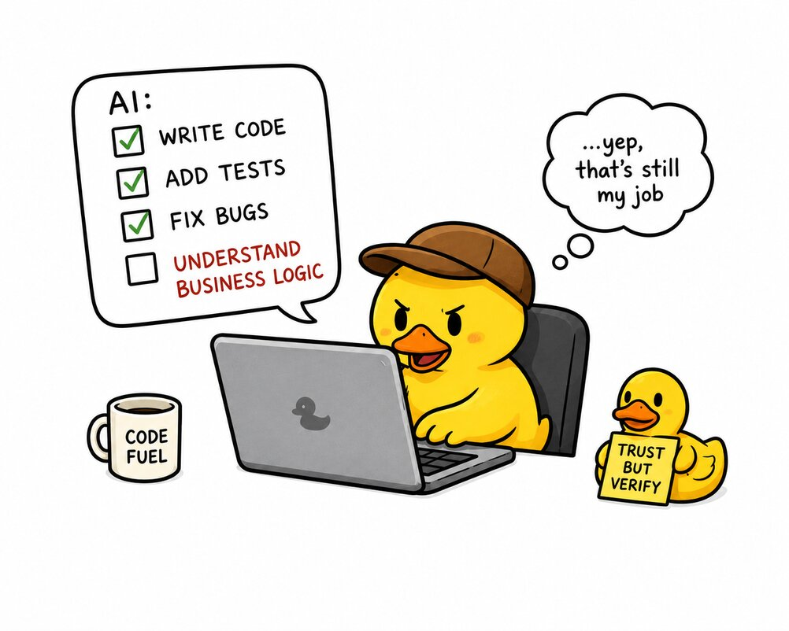

# AI-Assisted Development

<p align="center">
  
</p>

AI coding agents can significantly speed up development.

At the same time, without proper engineering constraints they often introduce:

- unnecessary abstractions
- duplicated logic
- unrelated refactoring
- inconsistent architecture
- unstable code quality

AI should accelerate implementation, not replace engineering responsibility. The developer is still responsible for
architecture, correctness, maintainability, security and code quality.

This document describes practical approaches for using AI coding agents in real-world projects. Nothing here depends
on a specific agent: the same setup works for Claude Code, Codex or any other client.

## Quality Gates First

Before integrating AI into your workflow, make sure your project already has strong quality gates.

The main idea: **a commit or a push that breaks the rules must not go through.** Gates enforced by git hooks do not care
who wrote the code. They work the same way for a developer, for Claude, for Codex, or for an agent that ignored its
instructions. That makes them more reliable than any agent-side hook, which only exists in one tool and only protects
what it was configured to protect.

Agents adapt quickly to a strict pipeline: a rejected commit returns the exact error, the agent fixes it and tries
again. The better your validation pipeline is, the better the generated code becomes.

At minimum, your project should include:

- strict TypeScript configuration
- ESLint and Prettier
- a pre-commit hook for fast checks on staged files
- a pre-push hook for slower checks on the whole project
- CI checks

This repository uses Husky with three hooks:

| Hook         | What it runs                                                                                               |
| ------------ | ---------------------------------------------------------------------------------------------------------- |
| `pre-commit` | lint-staged: Prettier and `eslint --fix` on staged files, `tsc --noEmit` when a `*.ts` file is staged      |
| `commit-msg` | commitlint (conventional commits) and a check that rejects AI attribution trailers                         |
| `pre-push`   | Knip (unused code), nestjs-doctor (architecture checks) and all unit tests with the 80% coverage threshold |

The `commit-msg` hook is a good example of a rule that belongs in a gate, not in instructions: an agent may forget a
line in `AGENTS.md`, but it cannot commit a message the hook rejects.

Tests are part of the gate, not an extra. Set a coverage threshold of at least 80% that fails the run, so code without
tests cannot pass. Agents write tests readily when asked; the threshold makes it non-optional, and a good test suite is
what lets you accept a large AI-generated change with confidence. In this repository `jest.coverageThreshold` in
`package.json` sets 80% for branches, functions, lines and statements, and the `pre-push` hook runs `npm run test:cov`,
so a push that drops the unit tests below the line is rejected.

Your CI pipeline should validate:

- linting
- formatting
- type checking
- unit tests
- e2e tests
- the API contract
- dependency and image vulnerabilities

E2E tests against real infrastructure are an important part of the backend quality pipeline. This project starts
PostgreSQL and Redis with Testcontainers for every e2e run, so generated queries, migrations and cache logic are checked
against the real services, not against mocks. CI also fails when the committed `docs/openapi.json` no longer matches the
controllers, so an agent cannot change the HTTP contract by accident.

The goal is simple: low-quality code should not be able to enter the repository.

## Architecture Before Generation

AI performs much better when the project structure already exists. Agents are pattern-oriented: they copy what they
see. Consistent code produces consistent output, mixed styles produce more mixed styles.

Before generating features with AI, define folder structure, naming conventions, module boundaries and core
abstractions. Then do two more things:

- **Write the architecture down.** A structure that lives only in the code has to be rediscovered by the agent in every
  session. A short description in `docs/` (see [Workflow](#workflow)) is read once and followed.
- **Keep one reference implementation per pattern.** Point the agent at it explicitly: "build the new feature the way
  `src/features/todos/` and `src/api/todos/` are built". One good example beats a page of rules.

This project demonstrates that approach. The layers (`src/api/` for controllers, `src/features/` for business logic,
`src/modules/` for infrastructure), naming conventions and `AGENTS.md` rules were established before any AI-assisted
feature generation, so generated code fits the existing architecture without manual correction.

## Workflow

The core idea: **the agent needs the most detailed description possible of the project and of the current tasks.** An
agent that knows the goal, the architecture, the constraints and the plan makes far fewer wrong guesses than one that
reverse-engineers them from the code.

### Context belongs to the repository

Context that lives in a chat history, in one developer's head or in one tool's private memory is lost at the next
session. Keep it in the repository:

- **All project context lives in `docs/` at the repository root.** Any client (Claude Code, Codex, another agent, a new
  team member) can read it, and it is versioned together with the code it describes.
- **Add `docs/` to `.prettierignore`.** These files are written for agents and edited by agents; Prettier has broken
  their structure before (tables, nested lists, checkboxes). The human guide stays formatted as usual.
- **Keep the rules in `AGENTS.md`, and make `CLAUDE.md` point to it.** Codex and most other agents read `AGENTS.md`;
  Claude Code reads `CLAUDE.md`, which needs only one line: `@AGENTS.md`. One set of rules, no copies to keep in sync.

### What goes into AGENTS.md

`AGENTS.md` should not describe the obvious. Modern models read `package.json`, the folder tree and the configs
themselves, so a list of dependencies or scripts in `AGENTS.md` only adds tokens and goes stale.

Write what the agent cannot infer from the code:

- what the project should look like and what quality bar it must meet
- non-obvious nuances and constraints
- how to work with the documentation in `docs/`

For example:

```markdown
## Planning

Before writing a new plan, read `docs/goal.md`, `docs/architecture/` and `docs/restrictions/`.
Plans follow `docs/plans/README.md`: a global plan with a design, plans and steps, each with a status.
End the design with open questions and your own calls to check; implement only approved plans.

## Documentation Rules

After every change, update the affected files in `docs/`. When you take a shortcut that a reader would not expect,
record it in `docs/hacks/`.
```

### The docs/ folder

A layout that works well:

```
docs/
├── goal.md          # what the project is and what it must achieve
├── architecture/    # overall architecture of the project
├── commands.md      # commands you or your agent use to work with the project
├── restrictions/    # constraints of this project
├── plans/           # what you are implementing now
├── ideas/           # raw, high-level ideas, not ready for work
├── roadmap/         # ideas worked out into future versions
├── benchmarks/      # performance results and notes (optional)
├── open-issues/     # known problems that are deferred
├── postmortem/      # attempts that did not work, and why
└── hacks/           # non-obvious decisions and shortcuts
```

Start small: a single file is fine until it grows, then turn it into a folder.

- **architecture** — the overall architecture: layers, module boundaries, data flow, key decisions.
- **commands.md** — the commands you or your agent run to work with the project, with a one-line purpose each. See the
  example below.
- **restrictions** — every project has its constraints: a dependency that cannot be upgraded, an API that must stay
  backward compatible, a platform that is not supported. Write them down once instead of running into them every time.
- **plans** — the most important folder: what you are implementing. A global plan contains a design, plans and steps,
  each with its status, and ideally the version it ships in. See [Task Decomposition](#task-decomposition).
- **ideas** — your ideas at a very high level, while they are not ready for work.
- **roadmap** — ideas that have been worked out. Here you shape future versions and decide which features they include.
- **benchmarks** — useful when the project has metrics. Save the results before every release, and later you can see
  where performance dropped and when.
- **open-issues** — deferred open problems, so they are not rediscovered (or silently "fixed") in every session.
- **postmortem** — something you tried that did not help. Keep it for history: the problem (link the open issue), what
  was tried and the negative result. It stops the next session from repeating the same attempt.
- **hacks** — an important folder: every place where you cut a corner or made a non-obvious decision, and why. Without
  it, the agent "cleans up" exactly the code that must stay as it is.

With this context in place, the agent operates on facts instead of guesses.

Example `commands.md`:

````markdown
# Commands

## Development

```bash
npm run start:dev                 # API on http://localhost:3000, Swagger on /docs
npm run db:migrate -- <name>      # create a migration after a schema change
npm run token:issue -- <userId>   # sign a JWT for a seeded user
```

## Checks

```bash
npm run lint           # tsc --noEmit and ESLint
npm test               # unit tests
npm run test:e2e       # e2e tests on PostgreSQL and Redis containers; needs Docker
npm run openapi:check  # fails when docs/openapi.json no longer matches the code
```

## Rules

- For an isolated change, run only the affected spec file: `npx jest src/features/todos/todos.service.spec.ts`.
- Never run `npm run release` without an explicit request.
````

This repository follows the layout above in [docs/](../docs/). It omits `benchmarks/`, keeps the committed HTTP
contract [docs/openapi.json](../docs/openapi.json) next to the agent docs, and the public roadmap stays in
[roadmap.md](../roadmap.md).

### Tune your harness

The agent is only as effective as the tools around it. Give it small helper scripts for the things it does every day:
show the status of a task or a plan, prepare a review package for a branch, run only the tests affected by a change.
A script is deterministic, cheap to run and produces the same output every time, which a free-form instruction cannot
guarantee.

Repeated actions can also become skills or custom commands of your agent: define them once, invoke them by name. Good
candidates are commits in the project's convention, running a specific test suite or scaffolding a new feature.

### Superpowers

I recommend [Superpowers](https://github.com/obra/superpowers), a set of skills that gives the agent a disciplined
development process. Three of them are critical for the workflow in this chapter:

- **brainstorming** — when shaping ideas and plans: the agent asks questions one at a time, offers alternatives and
  agrees the design with you before anything is written.
- **writing-plans** — turns the agreed design into a plan with small steps, exact files, interfaces and the tests that
  prove each step (see [Task Decomposition](#task-decomposition)).
- **subagent-driven-development** — implements the plan with a fresh subagent per step, a review after each step and
  a review of the whole branch at the end.

The process costs a lot of tokens: every step gets its own implementer and reviewer. If the project is not very complex
or critical, you can do without it and implement the plan in one session yourself.

## Pre-Hooks

Agent-side hooks run before the agent uses a tool and can block the action. This repository has Claude Code hooks in
[`.claude/settings.json`](../.claude/settings.json): they deny edits of `database-manager/migrations/` (migration files
are the history Prisma replays), `package-lock.json`, `.env*`, `CHANGELOG.md`, `dist/` and `coverage/`. A `Bash` matcher
is the place to block destructive commands such as `--legacy-peer-deps`, `git push --force` and `git reset --hard`; this
repository does not configure one.

They are a useful second line of defence, but they only exist in one tool. Anything that must hold for every agent
belongs in the git hooks described in [Quality Gates First](#quality-gates-first).

## Task Decomposition

Before the agent writes any code, it gets a high-level task and turns it into a plan. You do not write detailed prompts
for every step: the project context comes from `AGENTS.md` and `docs/`, the details come from the plan.

Small changes (a typo, a one-line fix) do not need this. Anything that touches more than one module or needs a
decision does.

### 1. State the task at a high level

Describe what you want and why, in your own words: the intent, the goals, what is out of scope, the target version.
Do not prescribe files and functions; that is what the plan is for.

```text
Add tags to todos: a user can attach tags to a todo and filter the list by tag, and the cache stays correct.
Target version 1.2.0. Sharing tags between users is out of scope.
```

### 2. Let the agent write the plan

The agent writes a global plan with plans and steps inside it, three levels deep:

```
docs/plans/
├── README.md                      # all global plans in priority order, with their statuses
└── 003-todo-tags/                 # global plan
    ├── readme.md                  # status, version, goal, its plans in order, conclusions
    ├── 00-design.md               # intent, goals, non-goals, the design, open questions, decisions
    ├── 01-data/                   # plan
    │   ├── readme.md              # status, its steps in order, conclusions
    │   ├── 01-schema-and-sql.md   # step
    │   └── 02-repository.md       # step
    └── 02-api/                    # plan
        ├── readme.md
        └── 01-dtos-and-controller.md
```

Every global plan, plan and step opens with the same header:

```markdown
**Status:** 📝 draft · **Version:** 1.2.0 · **Date:** 2026-11-05 · **Modules:** src/features/todos, src/api/todos
```

Statuses: 📝 draft · ✅ approved · 🔨 in progress · ⏸ hold · ✔️ done · 🔒 closed (stopped, with the reason) · ❌ failed
(tried and did not work, linked to `docs/postmortem/`).

A step is small enough for one agent session and one commit. It names the files, the interfaces it produces for the
next steps and the tests that prove it is done.

### 3. Answer the questions

The design ends with three lists:

- **Open questions** — what the agent cannot decide on its own.
- **Decisions** — your answers, dated. They are not revisited later.
- **Agent's calls (to check)** — choices the agent made itself; confirm or overrule each one.

Answer in the file, not only in the chat. The next session reads the plan, not the conversation.

### 4. Validate and approve

Check the design against `docs/goal.md`, `docs/architecture/` and `docs/restrictions/`, read every plan and step, and
fix what is wrong or missing. Only then move the plan from 📝 draft to ✅ approved. Only approved plans are implemented.

### 5. Close with conclusions

Every global plan and plan keeps a **Conclusions** section, filled in as the work is done: what was measured, what you
decided, what was learned. A plan is done when its conclusions are written and you have looked at its result. An
attempt that did not work becomes ❌ failed with a note in `docs/postmortem/`, so nobody repeats it.

## Legacy Projects

If your project was developed before AI agents came in, prepare it first. An agent dropped into an undocumented
codebase copies whatever it finds, including the inconsistencies. To start using agents effectively:

1. **Analyze the project.** Let the agent walk through the code with you: layers, modules, data flow, conventions, and
   where the code does not follow them.
2. **Create `docs/` and describe the current architecture** in `docs/architecture/`: how the project is built today,
   not how it should be.
3. **Introduce `AGENTS.md`** with the quality bar, the conventions and the rules for working with `docs/`, and make
   `CLAUDE.md` point to it.
4. **Complete the style guides and raise test coverage to at least 80%.** Lint rules and tests are what keep generated
   code in line (see [Quality Gates First](#quality-gates-first)). Without tests, every AI change to legacy code is a
   gamble.
5. **Write `docs/goal.md`:** what the project is for and where it is going.
6. **Find the restrictions and the hacks** and write them down in `docs/restrictions/` and `docs/hacks/`. Legacy code
   is full of decisions nobody remembers the reason for; this is where the agent learns not to "fix" them.
7. **Continue development through planning** (see [Task Decomposition](#task-decomposition)).

## Common AI Problems

AI-generated code often fails in predictable ways:

- overengineering and unnecessary abstractions
- duplicate utilities
- inconsistent naming
- unrelated refactoring
- ignoring existing architecture
- "fixing" an intentional shortcut
- retrying an approach that already failed

The `docs/` folder addresses most of them directly: `architecture` and a reference implementation keep the structure,
`restrictions` and `hacks` protect deliberate decisions, `postmortem` records what not to try again.

## Cost Optimization

Large context windows increase both token usage and reasoning instability.

To reduce cost and improve output quality:

- read only relevant files
- avoid scanning the entire repository
- run only affected tests
- keep tasks small and isolated

Good documentation is a cost optimization too: an agent that can read `docs/architecture/` and `docs/commands.md` does
not need to explore the repository to find out how it works.

Example **AGENTS.md** section:

```text
## Cost Saving Rules

- Run only affected tests
- Avoid full test suite runs for isolated changes
- Read only files related to the task
- Avoid repository-wide scans unless necessary
```

## Quality Control

AI-generated code should always be reviewed and validated manually.

Even strong AI coding agents can miss edge cases, introduce hidden bugs, misunderstand business logic or produce overly
complex solutions. AI assistance does not remove engineering responsibility.

### Commit Frequently

Each completed step of a plan should become a separate commit. Small commits make it easy to roll back a problematic
change, find where a regression came from and review generated code incrementally.

### Validate Edge Cases

AI often handles the "happy path" well but misses edge cases.

Always verify:

- invalid inputs
- boundary conditions
- error handling
- empty states
- concurrency scenarios
- permission checks

If edge cases are missing, ask the agent to extend the tests, or improve the implementation by hand.

### Mandatory Code Review

AI-generated code goes through the same review as manually written code: personal review, team review and automated
analysis.

A review checklist in the repository ([REVIEW.md](../REVIEW.md) here) gives both people and agents the same criteria.
Tools such as [SonarCloud/SonarQube](https://www.sonarsource.com/products/sonarqube/cloud/) add static analysis on pull
requests; this project includes `eslint-plugin-sonarjs` in its ESLint configuration, so a subset of SonarQube-style
rules runs on every commit through lint-staged and in CI.

### Never Trust AI Blindly

If generated code looks unclear or suspicious, ask the agent to explain it, request a simpler implementation, or rewrite
it by hand.

Do not merge code you do not fully understand. The final responsibility for the codebase always belongs to the developer
and the team.

## Recommended Workflow

1. Capture the idea in `docs/ideas/`; when it is worked out, move it to `docs/roadmap/` and assign a version.
2. Give the agent the task at a high level and let it write a global plan with plans and steps in `docs/plans/`.
3. Answer the open questions, check the agent's calls, validate the plan against `docs/goal.md`,
   `docs/architecture/` and `docs/restrictions/`, then approve and commit it.
4. Implement step by step; each step ends with a commit that passes the git hooks.
5. Review the generated code after each step and update the statuses in the plan.
6. Record what you learned: conclusions in the plan, shortcuts in `docs/hacks/`, deferred problems in
   `docs/open-issues/`, failed attempts in `docs/postmortem/`.
7. Run the full checks and review all changes before opening a pull request.

AI coding agents are most effective when used as controlled engineering accelerators, not autonomous developers.
